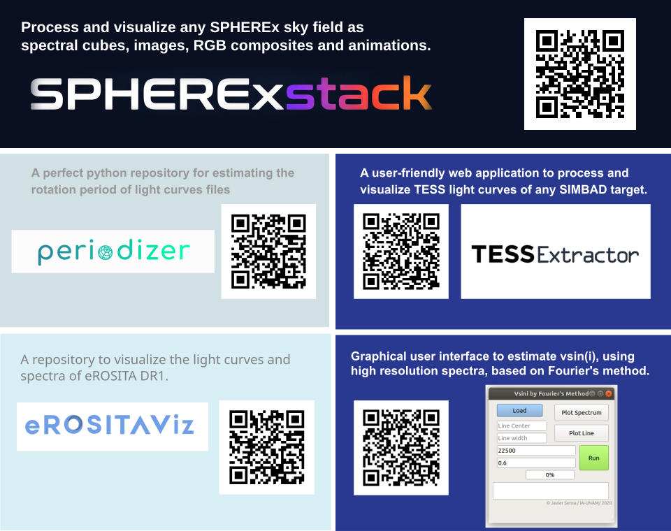

I'm Javier 🛰️₊ ⊹💫
---
**Astrophysicist | Data Scientist | Scientific Software Developer**

I build open-source scientific software and data pipelines to analyze multi-wavelength surveys from space and ground-based observatories (TESS, SPHEREx, JWST). My work focuses on tracing stellar rotation and accretion dynamics, as well as characterizing circumstellar dust and molecular ice chemistry in young stellar environments.

### Check out my portfolio of repositories and applications:

### My Stats:

  

